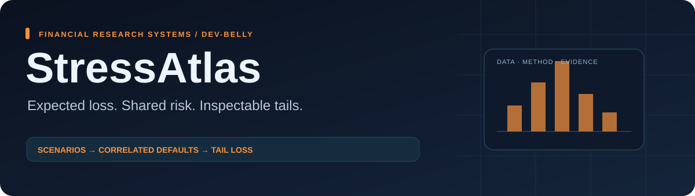

# StressAtlas

**Credit portfolio stress tests that distinguish marginal risk from clustered defaults.**

[](https://github.com/dev-belly/StressAtlas/actions/workflows/ci.yml)
[Open the online report](https://dev-belly.github.io/StressAtlas/) · [中文说明](README.zh-CN.md) · [Model and tail math](docs/METHODOLOGY.md) · [Data contract](docs/DATA_CONTRACT.md) · [Case study](docs/CASE_STUDY.md) · [Interview notes](docs/INTERVIEW.md)

Scenario assumptions are explicit. All scenarios reuse the same global, sector and obligor-level random drivers. Multiple loans to one borrower share one default event. The resulting report includes analytic expected loss, simulated mean and sampling error, discrete VaR/ES, paired scenario differences and additive sector attribution.


## Run in one minute

Python 3.11+ and Git are required. Both paths use a virtual environment directly,
without activation, and install a regular package.
Installation needs internet access; the generated synthetic report works offline.

**Linux / macOS**

```bash
git clone https://github.com/dev-belly/StressAtlas.git
cd StressAtlas
python3 -m venv .venv
.venv/bin/python -m pip install -r requirements-replay.txt
.venv/bin/python -m pip install .
.venv/bin/python -m stressatlas demo --out outputs
.venv/bin/python -m stressatlas verify --out outputs
```

**Windows (PowerShell)**

```powershell
git clone https://github.com/dev-belly/StressAtlas.git
cd StressAtlas
python -m venv .venv
.\.venv\Scripts\python.exe -m pip install -r requirements-replay.txt
.\.venv\Scripts\python.exe -m pip install .
.\.venv\Scripts\python.exe -m stressatlas demo --out outputs
.\.venv\Scripts\python.exe -m stressatlas verify --out outputs
```

Open `outputs/report.html` in a browser. The default synthetic fixture has
**160 loans, 80 obligors, 4 sectors and 20,000 paths**. Successful verification
prints `"verified": true`, `"files": 6` and `"replayed_paths": 20000`.
The report lets you switch between loss histograms and sector contributions.
Use a separate output directory for each trial; report commands can replace files.
Later examples use the installed `stressatlas` command: substitute
`.venv/bin/python -m stressatlas` on Linux/macOS or
`.\.venv\Scripts\python.exe -m stressatlas` on Windows when using this environment.

Saved-demo semantic replay requires the pinned versions and a compatible Linux numerical build. On Windows, generate a new local report and fully verify that report; version pins alone do not guarantee identical driver fingerprints across platforms. See the [numerical replay boundaries](docs/METHODOLOGY.md#reproducibility-and-limitations).

```bash
stressatlas demo --paths 100000 --seed 42 --out outputs-large
stressatlas run --inputs demo/inputs.json --out outputs-custom
```

[Contributing and validation](CONTRIBUTING.md) ·
[Report a reproducible problem](https://github.com/dev-belly/StressAtlas/issues/new?template=bug_report.md)

## Computed synthetic example

**160 loans · 80 obligors · 4 sectors · CNY 169.6m base EAD · 20,000 shared paths.** All PD/LGD/EAD inputs are synthetic assumptions, not calibrated borrower estimates.

| Scenario | Analytic EL / CNY m | 99% VaR / CNY m | 99% ES / CNY m |
| :--- | ---: | ---: | ---: |
| Baseline | 3.366 | 15.140 | 18.476 |
| Recession | 8.692 | 29.289 | 33.602 |
| Severe | 19.270 | 51.326 | 57.176 |
| Independent defaults | 3.366 | 8.718 | 9.621 |
| Higher asset correlation | 3.366 | 22.085 | 27.706 |

The last two scenarios keep marginal PD, LGD and EAD fixed. Analytic expected loss is unchanged; this simulated portfolio's tail changes substantially. Correlation changes are not guaranteed to increase every individual path or every portfolio quantile.

Source: [saved scenario table](demo/scenarios.csv), [sector attribution](demo/sector_es.csv), [normalized inputs](demo/inputs.json), [summary and driver fingerprint](demo/summary.json).

## Diagnose Monte Carlo tail precision

The separate precision report resamples complete paths with the same indices
across all scenarios. It recomputes mean loss, VaR, exact empirical ES and their
paired changes, reporting approximate percentile intervals and bootstrap SE.
These diagnose sampling variation under fixed model assumptions; sparse and
discrete tails can make coverage unreliable.

```bash
stressatlas precision --inputs demo/inputs.json --resamples 300 --out outputs/precision
stressatlas verify-precision --out outputs/precision
```

[Online precision report](https://dev-belly.github.io/StressAtlas/precision/) ·
[Method and worked example](docs/PRECISION.md) ·
[Interval rows](demo/precision/intervals.csv) · [All resamples](demo/precision/resamples.csv)

## Details that matter

- **Borrower identity:** splitting a loan does not create independent default events.
- **Common random numbers:** compare scenario losses path by path; report the standard error of paired differences.
- **Discrete tails:** ES integrates exactly the worst `N × (1−α)` path-equivalents, including fractional boundary mass. Averaging every loss `>= VaR` can be wrong when losses are tied.
- **Attribution:** sectors share the portfolio-tail weights; boundary ties share weight equally. Contributions sum to portfolio ES and do not depend on tie order.
- **Numerical checks:** exact PD=0/1, analytic EL agreement, scenario monotonicity under fixed correlation, seed/order/chunk invariance and rehashed-report corruption regressions.

## Artifacts and limits

`inputs.json` and the saved seed regenerate all paths. `loss_sample.csv` contains only the first 200 paths; it is **not the full tail sample**. The manifest checks six artifacts; verification also reruns the model. Its hashes do not authenticate external source data.

The model has one-period Gaussian factors with deterministic scenario LGD/EAD. It does not model rating migration, contagion networks, dynamic recovery, cash flows or macro calibration. It is not an implementation of Basel regulatory capital. Mean Monte Carlo SE is not a VaR/ES confidence interval.

The random driver bank is held in memory (`O(paths × obligors)`); chunking bounds the latent-loss intermediates, not the whole simulation's memory. There is no claim of production-scale throughput. MIT license.
