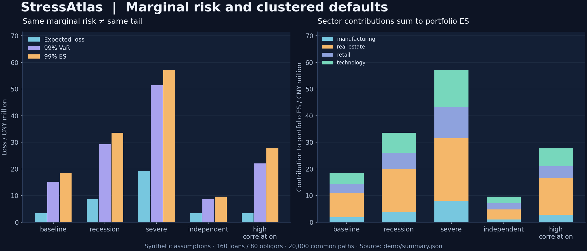

# StressAtlas｜信用组合压力测试

**单个借款人的违约概率不变，整个贷款组合的极端损失为什么还会变大？**

如果借款人的违约更加集中，平均损失可能基本不变，但最坏情形的损失会变大。StressAtlas 用全局、行业和借款人自身三个随机驱动模拟违约，比较压力情景并把尾部风险分配到行业。



## 快速运行

需要 Python 3.11+ 和 Git。两条路径都直接调用虚拟环境，无需激活，
并安装普通软件包；安装时需要联网，生成的合成报告可以离线查看。

**Linux / macOS**

```bash
git clone https://github.com/dev-belly/StressAtlas.git
cd StressAtlas
python3 -m venv .venv
.venv/bin/python -m pip install -r requirements-replay.txt
.venv/bin/python -m pip install .
.venv/bin/python -m stressatlas demo --out outputs
.venv/bin/python -m stressatlas verify --out outputs
```

**Windows（PowerShell）**

```powershell
git clone https://github.com/dev-belly/StressAtlas.git
cd StressAtlas
python -m venv .venv
.\.venv\Scripts\python.exe -m pip install -r requirements-replay.txt
.\.venv\Scripts\python.exe -m pip install .
.\.venv\Scripts\python.exe -m stressatlas demo --out outputs
.\.venv\Scripts\python.exe -m stressatlas verify --out outputs
```

打开 `outputs/report.html` 查看离线报告。默认合成样例包含 **160 笔贷款、80 个借款人、
4 个行业和 20,000 次模拟**。核验成功会输出 `"verified": true`、`"files": 6`
和 `"replayed_paths": 20000`。每次试用换一个输出目录，报告命令可能替换已有文件。
下文的 `stressatlas` 命令在 Linux/macOS 中可替换为 `.venv/bin/python -m stressatlas`，
在 Windows 中替换为 `.\.venv\Scripts\python.exe -m stressatlas`。

保存的演示报告完整重放还要求固定版本及兼容的 Linux 数值构建。Windows 可在本机生成新报告，再完整验证该报告；仅固定版本不能保证跨平台随机驱动指纹相同。详见[数值重放边界](docs/METHODOLOGY.md#reproducibility-and-limitations)。

[贡献与验证](CONTRIBUTING.md) ·
[反馈可复现的问题](https://github.com/dev-belly/StressAtlas/issues/new?template=bug_report.md)

## 减少随机驱动的内存占用

当前源码的五个命令都支持可选的 `--driver-mode stream`；默认仍为 `memory`。
流式模式按块重新生成同一组随机数，不再保存完整的“路径 × 借款人”驱动矩阵。
相同数值构建下，两种模式的随机指纹、损失路径和报告字节一致，也能交叉核验报告。

```bash
stressatlas demo --paths 100000 --driver-mode stream --out outputs-stream
stressatlas verify --driver-mode stream --out outputs-stream
stressatlas precision --inputs outputs-stream/inputs.json --resamples 300 --driver-mode stream --out outputs-stream/precision
stressatlas verify-precision --driver-mode stream --out outputs-stream/precision
```

本地独立进程试验使用 **50,000 条路径、400 个借款人、4 个行业、3 个合成情景**，
进程峰值 RSS 从 **352.2 MiB 降至 139.8 MiB**，用时从 **4.58 秒增至 5.44 秒**。
这是用更多随机数生成换取更少内存；完整损失路径、行业损失和 bootstrap 统计仍保存在内存。
这些结果不是生产规模或通用性能承诺。详见[可复现命令与测量口径](docs/METHODOLOGY.md#driver-memory-and-streaming)。
流式模式需要当前源码，早先的 v0.1.0 发行版本不包含它。

## 已实现的重点

- 同一借款人的多笔贷款共享一次违约，拆分贷款不会制造虚假分散效果。
- 所有情景复用同一组随机样本，输出逐路径配对差异及均值的蒙特卡洛标准误。
- 同时给出解析期望损失、模拟平均损失、99% VaR 和 ES。
- 离散 ES 按固定尾部质量计算，正确处理分数边界和并列损失。
- 行业使用同一组组合尾部权重，贡献之和等于组合 ES。
- 报告能从保存的输入、参数和随机种子完整重放；修改指标再更新哈希仍会被发现。
- 新增配对路径 bootstrap，重新计算 VaR/ES 与情景差异的近似区间及标准误；诊断固定模型下的模拟抽样波动，保留所有重采样统计量。

[在线精度诊断](https://dev-belly.github.io/StressAtlas/precision/) · [方法、范围与面试问答](docs/PRECISION.md)

```bash
stressatlas precision --inputs demo/inputs.json --resamples 300 --out outputs/precision
stressatlas verify-precision --out outputs/precision
```

合成演示：160 笔贷款、80 个借款人、4 个行业、基础敞口 1.696 亿元、20,000 次模拟。保持边际风险不变时，独立违约、基础相关性、较高相关性情景的解析期望损失都约为 336.63 万元；99% ES 分别约为 962.15 万、1,847.62 万、2,770.63 万元。

[数学方法](docs/METHODOLOGY.md) · [字段合同](docs/DATA_CONTRACT.md) · [完整案例](docs/CASE_STUDY.md) · [中文面试问答与简历表述](docs/INTERVIEW.md)

PD、LGD、EAD 均为合成假设。模型是一周期研究原型，没有真实银行组合、宏观参数校准或监管资本计算的声明。
